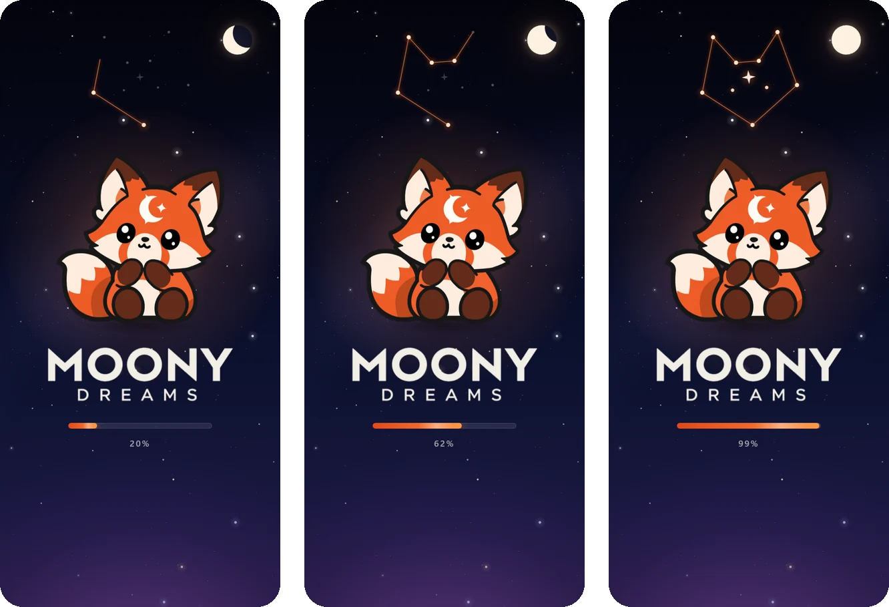
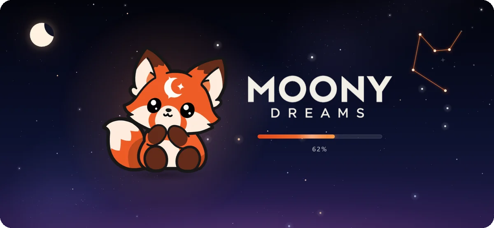
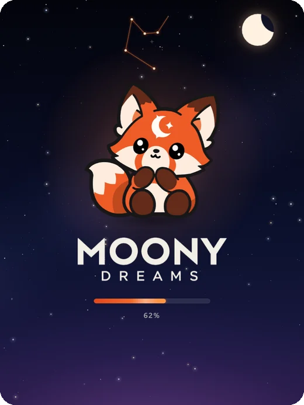

<p align="center">
  
</p>

<h1 align="center">Moony Dreams — загрузочный экран для плееблов</h1>

<p align="center">
  Один JS-файл без зависимостей, ≈55 KB, работает в любом HTML5-плеебле и MRAID-вебвью.<br>
  Ночное небо, созвездие лисы и луна, которые растут вместе с загрузкой.
</p>

<p align="center">
  
</p>

## Что внутри

- **Прогресс, вплетённый в иллюстрацию.** Вместе с полосой загрузки оранжевое созвездие лисы соединяется звезда за звездой,
  а полумесяц в углу растёт до полной луны. На 100% у созвездия загораются глаза и искра на лбу, как у маскота,
  оно вспыхивает, и экран плавно исчезает.
- **Адаптивная вёрстка.** Компоновка пересчитывается под реальный viewport: в портрете элементы стоят столбиком, в альбоме — в ряд.
  Учитываются safe-area (чёлки). На крошечных форматах (баннер 300×250) лишние детали скрываются.
- **Живое, но спокойное небо.** Звёзды и Млечный Путь рисуются на canvas, несколько звёзд мерцают, изредка пролетает метеор.
  Есть поддержка `prefers-reduced-motion`.
- **Готово для рекламных сетей.** Всё встроено в один файл (CSS, картинки в base64), ES5, нет сетевых запросов.
  Подходит для AppLovin, Unity Ads, ironSource, Mintegral, Google, Meta, TikTok.

## Форматы

| Телефон, альбом | Планшет |
|:---:|:---:|
|  |  |

<p align="center">
  
</p>

Все разрешения сразу можно посмотреть в [`loader/preview.html`](loader/preview.html):

```bash
python -m http.server 8765 --directory loader
```

Затем откройте http://localhost:8765/preview.html.

## Быстрый старт: упаковка в HTML5

Нужен Python 3. Pillow батник поставит сам.

- **Перетащите `index.html` игры на [`pack-html5.bat`](pack-html5.bat).** Лоадер встроится первым элементом `<body>`,
  файлы рядом с HTML (js, ассеты) скопируются, и в `build/html5/` появятся `<имя>/index.html` и `<имя>.zip`.
- **Двойной клик по батнику** соберёт чистый HTML5-шаблон с лоадером, в который можно вставить игру.

Из консоли:

```bash
pack-html5.bat path\to\game\index.html --name my_playable
```

Если сборка больше 5 MB (лимит большинства сетей), скрипт предупредит.

По умолчанию лоадер скрывается на событии `window.load`. Если игра умеет сообщать реальный прогресс, управляйте лоадером сами:

```js
window.MOONY_LOADER_MANUAL = true;      // до события load

MoonyLoader.setProgress(0.4);           // 0..1
MoonyLoader.finish(function () {        // бар до 100%, вспышка, плавное исчезновение
  startGame();
});
```

Для Unity WebGL передавайте прогресс из `createUnityInstance(canvas, config, MoonyLoader.setProgress)`.
Остальные опции (`minDuration`, `fakeProgress`, `starDensity`, `meteors`, `parent` и др.) описаны в [`loader/README.md`](loader/README.md).

## Структура

```
assets/              маскот и логотип с прозрачным фоном
loader/
  src/               исходники: moony-loader.js, moony-loader.css, demo.html
  dist/              собранный moony-loader.js (всё встроено) и demo.html
  build.py           сборка src + assets -> dist
  pack.py            упаковка в HTML5 (index.html + zip)
  preview.html       превью на 10 разрешениях
pack-html5.bat       батник для упаковки
docs/screenshots/    картинки для этого README
```

После правок в `loader/src` или `assets` пересоберите файл командой `python loader/build.py`
(батник делает это автоматически).
